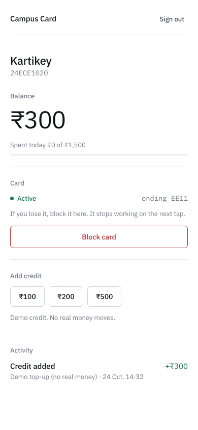
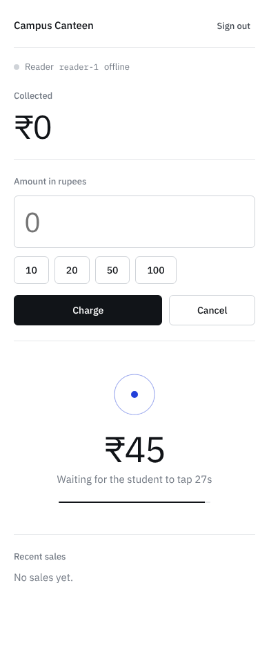
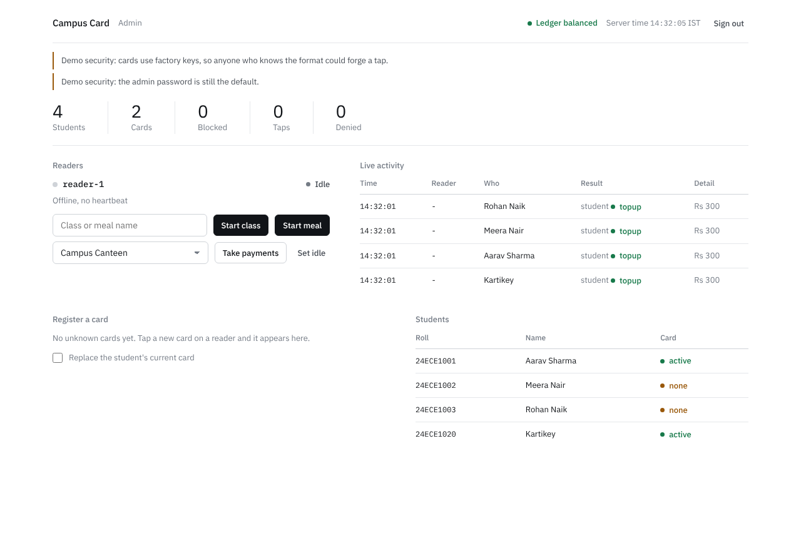

# Campus NFC card (NIT Goa techexpo prototype)

One NFC card per student. The same card marks attendance, counts mess meals and pays vendors from a
server-side campus credit balance. The card holds no money and no data worth stealing: each tap produces
a one-time signed URL (NTAG 424 DNA SUN/SDM) and the server decides everything.

Prototype hardware: one ESP32 + PN532 + OLED reader that switches between classroom, mess and vendor
mode, plus a laptop server and three web pages (admin, student, vendor).

<p>


</p>


## Status

| Part | State |
|---|---|
| Server, ledger, rules, pages | Done. 91 automated tests pass. Rehearsed over real HTTP with `tools.smoke`. |
| Card crypto (SDM verification) | Done. Checked against the NXP test vector. |
| Software reader (`tools.simtap`) | Done. Lets you run the whole demo with no hardware. |
| Reader firmware | Written, host-tested (protocol, HMAC, parsing, chunked NDEF read). **Never run on a real ESP32/PN532.** |
| Card provisioning (keys + SDM settings) | Offsets and NDEF file are generated (`tools.provision_plan`). **Writing them to a real card is not done or tested.** |
| WSL2 to ESP32 network path | Steps below. **Untested.** |

## Setup (WSL)

Run it from the WSL home folder, not from `/mnt/c/...`. SQLite WAL is unreliable on the Windows mount and
the server refuses to start there.

```bash
cp /mnt/c/Users/karti/Downloads/nfc-campus.zip ~/
cd ~ && unzip nfc-campus.zip && cd nfc-campus
python3 -m venv .venv && source .venv/bin/activate
pip install -r requirements.txt
python -m pytest -q                      # should say 91 passed
```

Seed the database (prints the reader secret; keep it for the firmware config):

```bash
python -m tools.seed --reset --sim --device-secret 00112233445566778899aabbccddeeff
```

`--sim` registers two software cards. Real cards: `--card 24ECE1020=04AABBCCDDEE11` (roll number = 7 byte UID in hex).

Start the server:

```bash
export CAMPUS_ADMIN_PASSWORD=choose-something
uvicorn app.main:app_factory --factory --host 0.0.0.0 --port 8000
```

Pages: `/` (links), `/admin.html`, `/student.html`, `/vendor.html`.

Demo logins: student `24ECE1020` PIN `1234`, vendor `canteen` PIN `1234`, admin password
`admin123` unless you set `CAMPUS_ADMIN_PASSWORD`. Change these before showing it to anyone outside the stall.

## Run the demo without hardware

```bash
python -m tools.smoke --secret 00112233445566778899aabbccddeeff --server http://127.0.0.1:8000
```

This walks a 17 step story: mess meal, attendance, payment, duplicate tap, no funds, changed amount,
block and unblock, unregistered card, tampered tap, ledger check. `tools.simtap` does single taps by hand
(`python -m tools.simtap --secret <hex> tap --help`).

## Configuration

| Variable | Default | Meaning |
|---|---|---|
| `CAMPUS_DB` | `data/campus.db` | SQLite file |
| `CAMPUS_KEY_MODE` | `default` | `default` = factory zero keys, `diversified` = per-card keys from the master key |
| `CAMPUS_MASTER_KEY` | none | 32 hex chars, needed for `diversified` |
| `CAMPUS_META_KEY` | zero key | Key that encrypts the UID/counter in the URL |
| `CAMPUS_ADMIN_PASSWORD` | `admin123` | Admin page login |

Limits: 500 per charge, 1500 per day, 5000 max balance, 2000 max top-up, 30 s to tap after a charge is
armed. The admin page warns while factory keys or the default password are in use.

## Cards

The NTAG 424 DNA must be configured so that reading its NDEF file returns a URL with an encrypted
UID+counter and a MAC. `python -m tools.provision_plan` prints the NDEF file and the offsets
(PICCDataOffset 24, SDMMACOffset 59 for the default template). Applying them needs a ChangeFileSettings
command after authenticating with the card key, from a tool that can talk to the card.

Before ordering more or relying on the Etsy cards, ask the seller: do the tags ship with the default
all-zero keys and SDM switched off? If the seller already changed the keys, they will not work with the
default key mode.

## Reader on the ESP32

See `firmware/reader/README.md` for wiring, the Arduino build and a bench checklist. Copy
`config.example.h` to `config.h` and fill in Wi-Fi, server URL and the device secret.

### Letting the ESP32 reach the server in WSL2

The server must listen on `0.0.0.0` (as above). Then one of these. Both are from Microsoft's WSL
networking page and have not been tried on this laptop.

**Option A, mirrored networking (Windows 11 22H2 or later).** Create `C:\Users\karti\.wslconfig`:

```ini
[wsl2]
networkingMode=mirrored
```

Then in an admin PowerShell:

```powershell
wsl --shutdown
Set-NetFirewallHyperVVMSetting -Name '{40E0AC32-46A5-438A-A0B2-2B479E8F2E90}' -DefaultInboundAction Allow
```

Use the laptop's Wi-Fi IP in `SERVER_URL`.

**Option B, port proxy (works on NAT mode).** In an admin PowerShell, with the IP from `wsl hostname -I`
(capital I):

```powershell
netsh interface portproxy add v4tov4 listenport=8000 listenaddress=0.0.0.0 connectport=8000 connectaddress=<WSL IP>
New-NetFirewallRule -DisplayName "campus-nfc 8000" -Direction Inbound -Protocol TCP -LocalPort 8000 -Action Allow
```

The WSL IP can change after a restart, so redo the `netsh` line if the reader stops connecting.
Put the laptop and the ESP32 on the same hotspot. Check from a phone on that hotspot first:
`http://<laptop IP>:8000/` should show the index page.

## Layout

```
app/        FastAPI server, ledger and rules (service.py), SDM crypto (sdm.py), schema (db.py), static pages
tools/      seed, smoke, simtap, simulator, provision_plan
firmware/   reader sketch, hardware-free core.h, host tests and Arduino stubs
tests/      pytest suite
docs/       architecture notes and demo script
```

## Licenses

Code: MIT (see `LICENSE`). The bundled IBM Plex fonts in `app/static/fonts` are under the SIL Open Font License.
